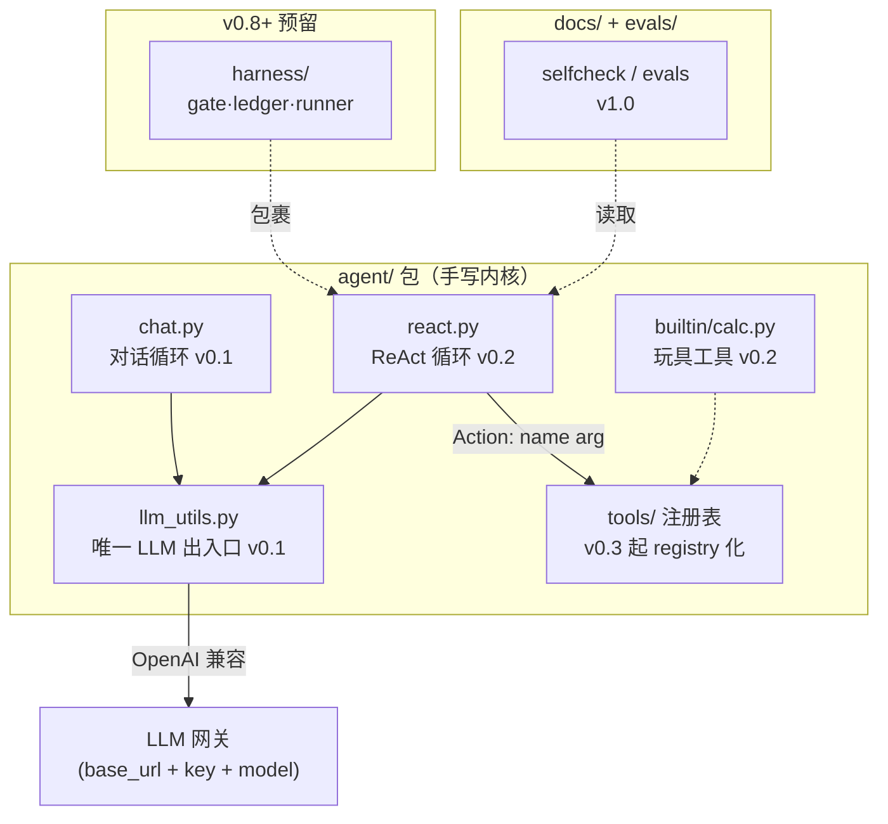

# 架构图：agent/ 内核装配（一图一文件）

> 规则出处：AGENTS.md §3 沉淀路径（docs/arch/，一图一文件，mermaid 优先）。

演化注记（v0.2 现状）：

| 组件 | 状态 | 下一版本归属 |
|---|---|---|
| chat.py / llm_utils.py | ✅ v0.1 | 不变 |
| react.py + calc.py | ✅ v0.2 | ch02 并入 tools/ 体系 |
| tools/ 注册表 | 计划 | ch02（v0.3） |
| memory/ | 计划 | ch04（v0.5） |
| harness/ | 计划 | ch07（v0.8） |
| evals/ | 计划 | ch08（v1.0） |

Sources: agent-camp-outline.md §4 拼装思路；agent-expert-outline.md 思维 #1/#2。访问日期 2026-11-02。
